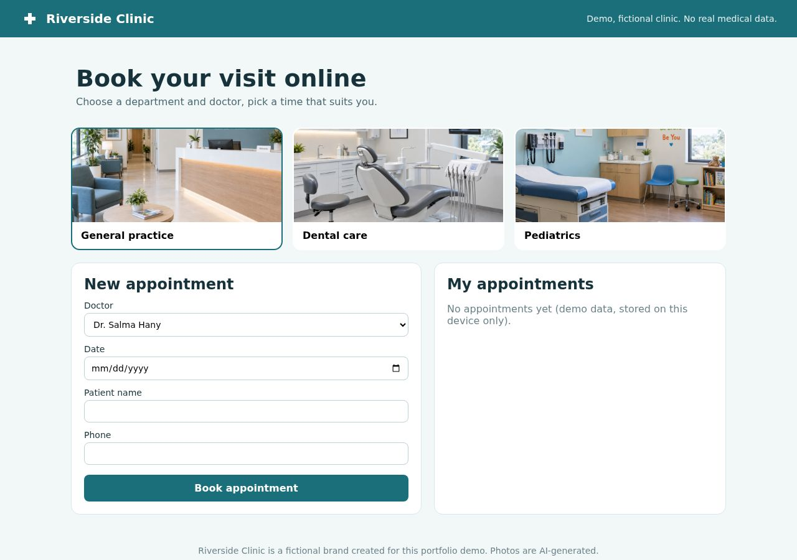
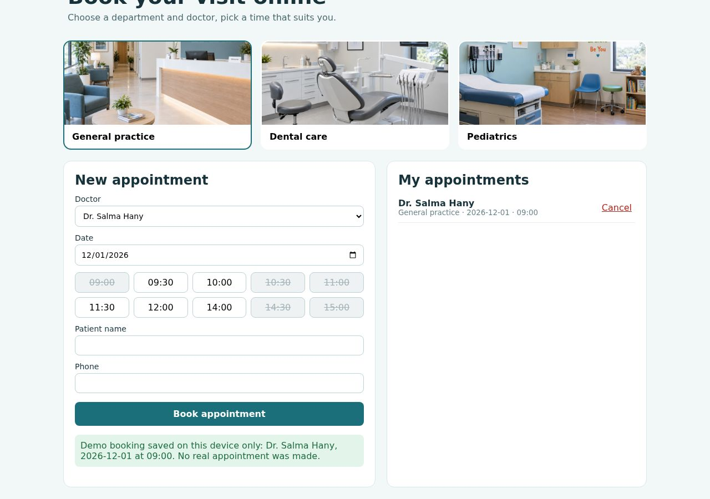
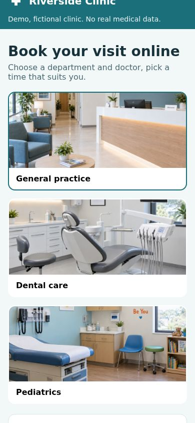

# Riverside Clinic Booking (React + Vite)

An appointment-booking demo for a fictional clinic. Doctors and the clinic are invented, photos are AI-generated, and no real medical data is used or stored beyond the browser.

## Features
- Three departments, each with its own doctors
- Date picker with time slots; booked and unavailable slots are disabled
- Availability is per doctor; closed on Fridays, no past dates. Double-booking prevention is demo state kept in this browser only (no server, no multi-user sync)
- Form validation, confirmation, "My appointments" list with cancel
- Appointments persist in the browser (localStorage)

## Run
```bash
npm install
npm run dev
npm run build
```

## Demo video
[docs/demo.mp4](docs/demo.mp4)

## Preview




## Tests
Headless Chrome checks (22): departments and doctors, validation (empty, bad phone, past date, Friday), slot availability per doctor, double-booking prevention (device-local demo state), booking, persistence after reload, cancel frees the slot, mobile overflow, console errors.
